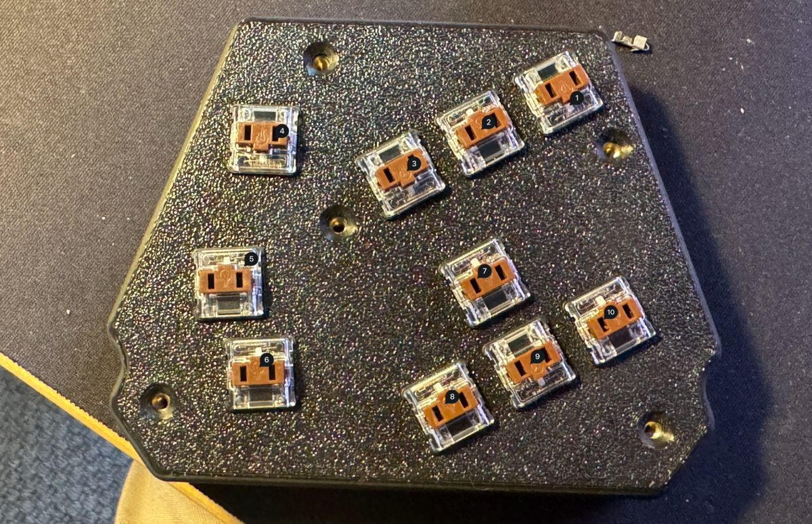

# Voyager10

A low-profile, hand-wired **10-key macropad** designed to sit between the halves of a [ZSA Voyager](https://www.zsa.io/voyager). Built with **Kailh Choc V1**, a **Seeed XIAO RP2040**, **QMK**, and a **3D-printed enclosure** designed in Shapr3D.

> Independent personal project. Not affiliated with or endorsed by ZSA.



## Keys

The numbers match the labels in the prototype photograph.

| Key | Action | XIAO pin / RP2040 GPIO |
|---:|---|---|
| 1 | Backspace | D0 / GP26 |
| 2 | `:` (macOS US layout) | D1 / GP27 |
| 3 | Hyper + 2 (host screenshot shortcut) | D2 / GP28 |
| 4 | Escape | D3 / GP29 |
| 5 | Hyper + K (clipboard manager) | D4 / GP6 |
| 6 | Hyper + N (notes) | D5 / GP7 |
| 7 | Up | D6 / GP0 |
| 8 | Left | **D9 / GP4** |
| 9 | Down | D8 / GP2 |
| 10 | Right | **D7 / GP1** |

**Note:** Keys 8 and 10 are deliberately swapped in the GPIO mapping to match the actual soldered wiring. Each switch is wired between its assigned GPIO and the shared GND. No matrix or diodes.

## Combos

| Keys | Result |
|---|---|
| 1 + 2 | Option + Backspace (delete word) |
| 1 + 2 + 3 | Command + Backspace (delete to line start) |
| 2 + 3 | `€` (macOS US layout) |
| 8 + 9 | Hyper + Left |
| 9 + 10 | Hyper + Right |
| 7 + 9 | Control + Up (Mission Control) |
| 8 + 10 | Control + Command + Q (lock Mac) |
| 1 + 4 while connecting USB | RP2040 bootloader |

Combos use an 80 ms window. Hyper means Control + Option + Shift + Command. For other macOS input layouts, adjust the `KEY_COLON` and `KEY_EURO` definitions in `keymap.c`.

## Build and flash (macOS)

This repository stores a custom keyboard definition, **not a fork of all QMK firmware**. First [install QMK](https://docs.qmk.fm/newbs_getting_started) and run `qmk setup`.

```sh
# From this repository's root:
make build
```

`make build` copies the custom keyboard to `~/qmk_firmware/keyboards/handwired/voyager10` and runs:

```sh
qmk compile -kb handwired/voyager10 -km default
```

To flash, hold the XIAO's physical **B** button while connecting USB-C, or hold keys **1 + 4** while connecting USB if that startup shortcut is already installed. The Mac should mount `RPI-RP2`.

```sh
make flash
```

Once bootloader mode is active, you can also copy `~/qmk_firmware/handwired_voyager10_default.uf2` to `/Volumes/RPI-RP2/` manually.

The previous local project was `handwired/voyager8`. This repository uses the consistent new name `handwired/voyager10`; it doesn't remove or overwrite the old project.

## Hardware and CAD

- [Wiring and switch dimensions](hardware/wiring.md)
- [Shapr3D / CAD notes](cad/README.md)
- [Development roadmap](PROJECT.md)

The printed prototype is shown above. The **current 10-key native Shapr3D and STEP design files have not been added yet**; export them from Shapr3D and commit them under `cad/` when ready. Earlier eight-key STEP designs are not interchangeable with this plate.

## Status

- 10-key prototype printed and wired; user-tested arrow keys and earlier combos.
- Current `:` and `€` mappings are based on the latest requested macOS US configuration; verify on hardware after compiling.
- Firmware in this repository has **not been compiled in the artifact-generation environment**. Compile with your local QMK installation before flashing.

No license has been selected yet. Choose one before making the repository public or accepting outside contributions.
